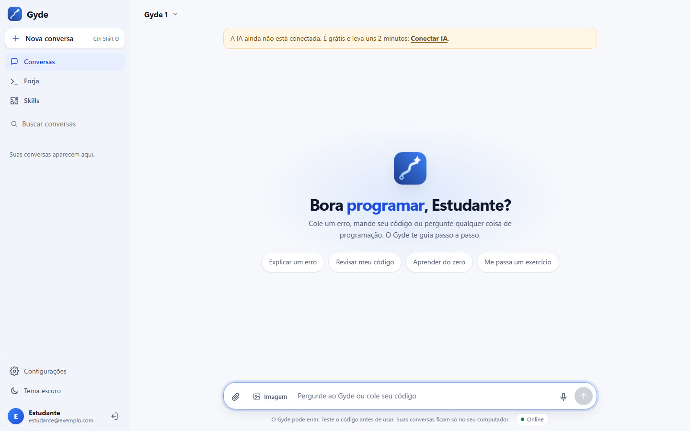
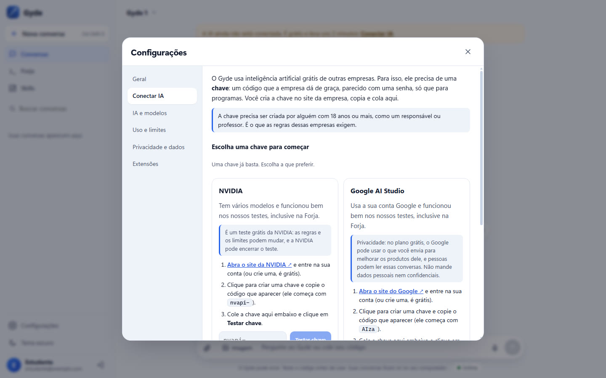
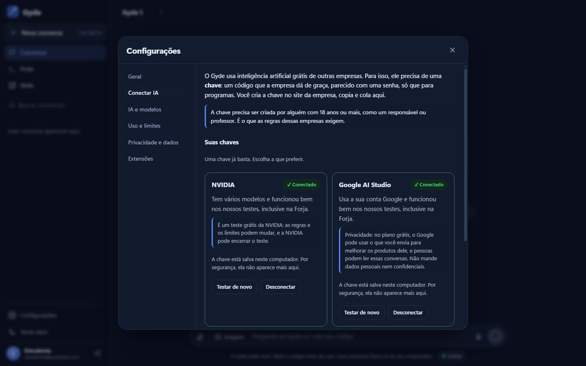
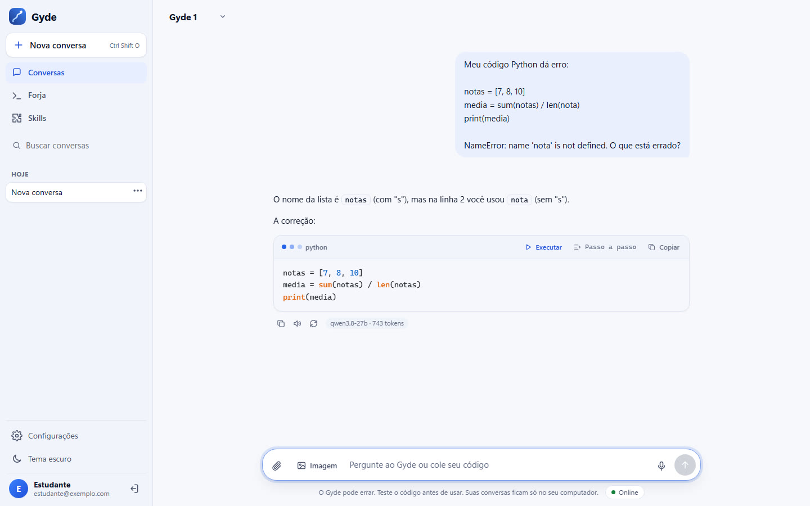
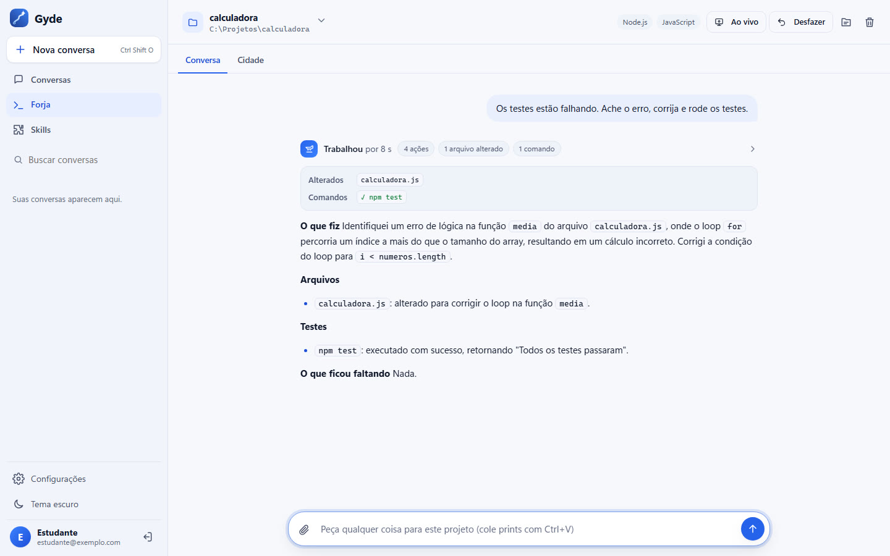
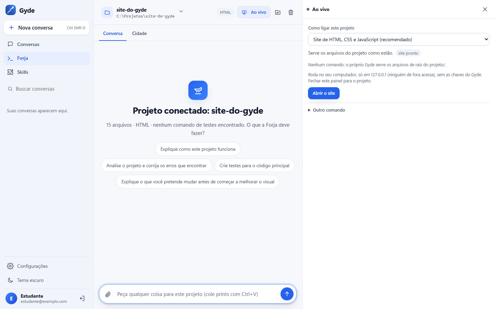
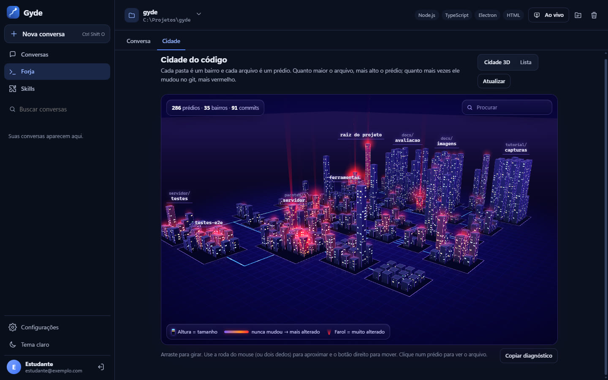

# Como instalar o Gyde

Este guia é para quem nunca instalou nada parecido. São uns 10 minutos, tudo grátis, e você não precisa ser
administrador do computador nem saber usar o terminal.

**Do que você precisa:** um computador com **Windows 10 ou 11** e internet.

---

## 1. Baixar o instalador

1. Abra a página **[Releases do Gyde](https://github.com/gustavomdeschamps/Gyde/releases/latest)**.
2. Na parte **Assets** (no fim da versão mais nova), clique em **`Gyde-Setup-2.1.0.exe`** (o número pode ser maior,
   se houver uma versão mais nova). O download começa.

## 2. Instalar

1. Abra o arquivo baixado (na pasta **Downloads** ou na barra de downloads do navegador).
2. **Se aparecer a tela azul "O Windows protegeu o computador"** (é o SmartScreen):
   - isso acontece porque o instalador não tem uma assinatura digital paga, não porque ele tem vírus;
   - clique em **Mais informações** e depois em **Executar assim mesmo**;
   - só faça isso se você baixou o arquivo da página oficial do Gyde no GitHub (o link do passo 1).
3. No instalador, escolha **Apenas para mim** e clique em **Próximo**, depois em **Instalar** e, no fim, em
   **Concluir**. Não precisa instalar Node.js nem outra coisa antes.

O Gyde abre numa janela própria. Para abrir de novo depois, procure **Gyde** no menu Iniciar.

## 3. Criar a sua conta

1. Na primeira tela, clique para criar uma conta e preencha nome, e-mail e senha.
   **A conta fica só no seu computador**: nada é enviado para um site do Gyde.
2. Responda o questionário rápido (seu nível e o que quer aprender). Ele adapta as explicações. Dá para refazer depois
   em **Configurações > Geral**.

## 4. Conectar a IA (2 minutos)

O Gyde usa inteligência artificial grátis de outras empresas. Para isso, ele precisa de uma **chave**: um código que a
empresa dá de graça, parecido com uma senha, só que para programas. **Uma chave já basta.**

> **Atenção:** a chave precisa ser criada por alguém com **18 anos ou mais**, como um responsável ou professor. É o que
> as regras dessas empresas exigem.

1. Clique em **Conectar IA** no aviso do topo (ou abra **Configurações > Conectar IA**).
2. Escolha **uma** das duas:
   - **NVIDIA:** abra [build.nvidia.com/settings/api-keys](https://build.nvidia.com/settings/api-keys), entre na sua
     conta (ou crie uma, é grátis) e crie uma chave. Ela começa com `nvapi-`. É um teste grátis da NVIDIA: as regras e
     os limites podem mudar.
   - **Google:** abra [aistudio.google.com/apikey](https://aistudio.google.com/apikey), entre com a sua conta Google e
     crie uma chave. Ela começa com `AIza`. No plano grátis, o Google pode usar o que você envia para melhorar os
     produtos dele: não mande dados pessoais nem confidenciais.
3. Copie a chave, cole no cartão da empresa que você escolheu e clique em **Testar chave**.
4. Apareceu **✓ Conectado**? Pronto. Por segurança, a chave não aparece mais na tela depois de salva.

**Opcional:** uma chave do **Groq** ([console.groq.com/keys](https://console.groq.com/keys)) deixa o chat mais rápido e
serve de reserva. Já usa o **FreeLLMAPI**? Ele continua em **Conectar IA > Avançado**.

## 5. A primeira conversa

Escreva uma dúvida ou cole um erro, por exemplo um código Python que não funciona. O Gyde mostra onde está o erro,
explica o porquê e só depois corrige. No topo, **Gyde 1** escolhe o modelo certo para cada pedido; o **Gyde 1 Pro** pede
para um segundo modelo conferir a resposta (mais lento). Embaixo de cada resposta aparece o modelo que respondeu.

## 6. A Forja no seu projeto

A **Forja** é o agente de código do Gyde: ela abre a pasta de um projeto e trabalha nos arquivos de verdade.

1. No menu da esquerda, clique em **Forja** e em **Conectar pasta do projeto**. Escolha a pasta.
2. Peça uma tarefa, como "os testes estão falhando, ache o erro e corrija".
3. A Forja mostra cada passo e, no fim, os arquivos alterados e os comandos que rodou. Antes de apagar arquivos ou
   instalar pacotes, ela pergunta. O botão **Desfazer** volta tudo.

## 7. A Cidade e o Ao vivo

- **Cidade:** na Forja, a aba **Cidade** mostra o projeto como uma cidade em 3D (cada pasta é um bairro, cada arquivo
  um prédio). Quando a Forja mexe num arquivo, o prédio acende. Prefere texto? Clique em **Lista**.
- **Ao vivo:** o botão **Ao vivo**, no topo da Forja, liga o seu projeto e mostra ao lado da conversa. O Gyde mostra o
  comando exato e só liga depois do seu clique (**Permitir e iniciar**, ou **Abrir o site** num site pronto). Fechar o
  painel para o projeto.

## 8. Extensões (opcional)

O Gyde também funciona dentro do **VS Code** e do **Chrome**. As duas usam o app do Gyde aberto e a IA que você
conectou nele.

1. No app, abra **Configurações > Extensões > Gerar token** e copie o token.
2. **VS Code:** instale a extensão **Gyde** (procure "Gyde" na aba Extensões do VS Code, ou instale o arquivo
   `gyde.vsix` da página Releases em **Extensões > … > Instalar do VSIX**). Clique no ícone do Gyde na barra da
   esquerda e em **Colar token**.
3. **Chrome:** siga o [guia da extensão do Chrome](pacotes/extensao-chrome/LEIA-ME.md) e cole o token no painel.

O token só serve para conversar: com ele, as extensões não leem nem mudam as suas chaves, as configurações ou os seus
dados.

---

## Se algo der errado

| O que aparece | O que fazer |
|---|---|
| "O Windows protegeu o computador" | Clique em **Mais informações** e em **Executar assim mesmo** (passo 2). |
| "A IA ainda não está conectada" | Faça o passo 4: **Configurações > Conectar IA** e cole uma chave grátis. |
| "A NVIDIA (ou o Google) recusou essa chave" | Copie a chave de novo, inteira, sem espaço no começo nem no fim. Se continuar, crie uma chave nova no site. |
| Respostas lentas ou "limite" | Os serviços grátis têm limite por minuto. Espere um pouco ou conecte uma segunda chave (por exemplo o Groq). O Gyde troca de modelo sozinho quando um está no limite. |
| A extensão diz "Não consegui falar com o Gyde" | Abra o app do Gyde e tente de novo. |
| A extensão diz "Token inválido" | Gere outro token em **Configurações > Extensões** e cole de novo. |
| O Ao vivo diz que falta Node.js, Python ou outro programa | Instale o programa indicado na mensagem e tente de novo. Se o erro for no código do projeto, use **Pedir à Forja para consertar**. |
| A Cidade 3D não mostra os prédios | O Gyde tenta sozinho um modo mais simples. Se continuar, use **Lista** e clique em **Copiar diagnóstico** para relatar o problema numa [issue](https://github.com/gustavomdeschamps/Gyde/issues). |
| Esqueci a senha | Na tela de entrada, use **Esqueci minha senha**. |

**Onde ficam os seus dados:** em `%APPDATA%\Gyde` (conta, conversas, chaves e configurações). Atualizar o Gyde
(instalar a versão nova por cima) mantém tudo. Desinstalar pergunta antes de apagar os seus dados.

**Sem internet:** o Gyde pode usar um modelo que roda no seu computador pelo [Ollama](https://ollama.com). Veja a parte
"IA offline" no [README](README.md#ia-offline-sem-internet).
