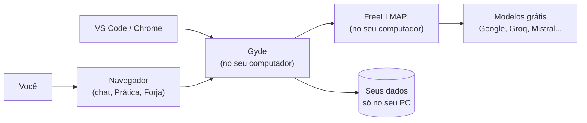

  

<h3 align="center">O tutor de programação com IA que ensina em vez de só entregar a resposta.</h3>

  Chat que explica o erro antes de corrigir · agente que programa sozinho no seu projeto · prática com XP ·
  extensões para VS Code e Chrome. Em português, de graça, rodando no seu computador.

  
  
  
  
  

  <a href="COMO-INSTALAR.md"><b>Instalar (passo a passo)</b></a> ·
  <a href="#o-que-o-gyde-faz">O que ele faz</a> ·
  <a href="#forja-o-agente-de-c%C3%B3digo">Forja</a> ·
  <a href="#extens%C3%B5es">Extensões</a> ·
  <a href="#perguntas-frequentes">Dúvidas</a>

---

## Por que o Gyde existe

Quem está começando a programar trava num erro, cola numa IA, recebe o código pronto e... não aprende nada.
O **Gyde** foi feito para o contrário: ele **mostra onde está o erro, explica o porquê e só depois corrige**,
no nível de quem está aprendendo. E quando você já sabe o que quer, a **Forja** (o agente de código do Gyde)
abre o seu projeto e faz o trabalho sozinha, como um desenvolvedor: escreve, testa, corrige e documenta.

Tudo roda **no seu computador**, com os modelos de IA **grátis** do [FreeLLMAPI](https://github.com/tashfeenahmed/freellmapi).
Suas conversas e seu progresso ficam só com você.

## O que o Gyde faz

### Chat de tutor
Cole um erro ou um código. O Gyde aponta a linha, explica a causa e mostra a correção. Os blocos de Python e
JavaScript têm o botão **Executar**, que roda o código ali mesmo.

### Passo a passo
O botão **Passo a passo** roda o código linha por linha e mostra o valor de cada variável a cada passo.
É o jeito mais fácil de entender um laço ou uma função.

### Prática
Trilhas de Python, JavaScript e lógica, **projetos guiados** com testes automáticos, **XP**, **desafio do dia**,
**sequência de dias** e **revisão dos erros** (o exercício que você errou volta depois de 1, 3, 7 e 21 dias).
Travou? A **Dica do Gyde** ajuda sem entregar a resposta.

### Forja, o agente de código
Um chat ligado à pasta de um projeto seu. Você pede, e a Forja **trabalha sozinha**: lê o código, cria e edita
arquivos, roda os testes até passarem e documenta. Cada ação aparece ao vivo, com o tempo que levou, os arquivos
alterados e as mudanças coloridas. Ela faz várias ações por rodada para responder rápido.

**Segurança da Forja:** só mexe dentro da pasta que você escolheu, não lê `.env` nem chaves, recusa a raiz do disco
e pastas como Documentos inteira, bloqueia comandos perigosos (formatar, desligar, apagar o disco) e tem um botão
**Parar** a qualquer momento.

### E mais
- **Skills:** habilidades instaláveis, como plugins (`/revisar`, `/git`, `/sql`...). Dá para criar as suas e publicar na loja de skills.
- **Quiz de boas-vindas:** o Gyde descobre o seu nível e adapta as explicações.
- **Turmas:** o professor cria a turma, passa exercícios com prazo e acompanha quem fez.
- **Memória:** o Gyde lembra o que você pedir para ele lembrar (dá para ver e apagar).
- **Revisar projeto inteiro:** anexe uma pasta ou um `.zip` e peça a revisão.
- **Imagens e voz:** gera imagens e lê as respostas em voz alta.
- **App:** instale pelo navegador como um aplicativo. Tema claro e escuro.
- **Vídeo de abertura** em 3D, com narração e legendas.

## Extensões

### VS Code
O Gyde dentro do editor: chat na barra lateral e, com o botão direito, **Explicar com o Gyde**,
**Revisar com o Gyde** e **Explicar o erro desta linha**. A resposta tem o botão **Inserir no editor**.
Veja [extensoes/vscode](extensoes/vscode/README.md).

### Chrome
Painel lateral que lê a página, a seleção ou um print, e um **modo agente**: você dá o comando e ele faz sozinho
na aba, com uma seta que clica e digita (e para antes de compras, exclusões e senhas).
Veja [extensoes/chrome](extensoes/chrome/LEIA-ME.md).

## Como funciona

O Gyde escolhe sozinho os melhores modelos para programar. Se um estiver ocupado ou fora do ar, o próximo da
fila assume, sem você perceber. Os limites grátis renovam todo dia, e quanto mais chaves grátis você colocar no
FreeLLMAPI, mais o Gyde aguenta.

## Instalar

**Siga o [COMO-INSTALAR.md](COMO-INSTALAR.md)**: o passo a passo completo, feito para quem nunca instalou nada
parecido. Leva uns 15 minutos.

Resumo:

1. Baixe este repositório (**Code → Download ZIP**) e extraia numa pasta fixa.
2. Instale o [FreeLLMAPI](https://github.com/tashfeenahmed/freellmapi/releases/latest) e coloque pelo menos uma chave grátis (ex.: Google AI Studio).
3. Dê dois cliques em **`instalar.bat`**.
4. Use o **`iniciar.bat`** sempre que quiser abrir o Gyde. Ele roda em http://127.0.0.1:3210.

> Cada pessoa tem o próprio Gyde: a conta, as conversas e o progresso ficam no computador de quem instalou,
> e cada um usa as próprias chaves grátis de IA.

## Perguntas frequentes

**É grátis mesmo?**
Sim. O Gyde é grátis e usa os limites grátis dos serviços de IA (Google, Groq, Mistral e outros) pelo FreeLLMAPI.

**Precisa de internet?**
Para a IA responder, sim. O app em si roda no seu computador.

**Meus dados vão para algum lugar?**
Sua conta, conversas e progresso ficam na pasta `data` do seu computador. As mensagens vão só para o serviço de IA
que responde.

**E quando o limite grátis acabar?**
O FreeLLMAPI troca sozinho de serviço. Os limites diários renovam todo dia (21h no horário de Brasília).

**Funciona no Mac ou no Linux?**
Foi feito e testado no Windows. O servidor é Node.js e roda em outros sistemas, mas os instaladores e a janela de
escolher pasta da Forja são do Windows.

## Estrutura do projeto

| Pasta ou arquivo | Para que serve |
|---|---|
| `instalar.bat` | Instala tudo na primeira vez |
| `iniciar.bat` | Abre o Gyde no dia a dia |
| `COMO-INSTALAR.md` | Passo a passo de instalação |
| `configurar/` | Extras: chave do FreeLLMAPI, imagens, voz, e-mail, trocar senha, extensão do VS Code |
| `extensoes/` | Extensões para VS Code (`vscode/`) e Chrome (`chrome/`) |
| `app/` | O programa: servidor (`server.js`), Forja (`codigo-agente.js`), modelos (`motor.js`), interface (`public/`) e skills (`skills-catalogo/`) |
| `docs/` | Imagens desta página |

Arquivos criados no seu computador e que **nunca** vão para o GitHub: `.env` (suas chaves) e `data/` (contas e conversas).

<b>Modo público e e-mail (para quem vai hospedar o Gyde para outras pessoas)</b>

- **Pessoal (padrão):** para usar no seu computador. Crie a conta com qualquer e-mail; nada é enviado e não há
  código para confirmar. Esqueceu a senha? Rode `configurar\redefinir-senha.bat`.
- **Público:** coloque `GYDE_MODE=publico` no `.env` e rode `configurar\configurar-email.bat`. As contas passam a ser
  confirmadas por código no e-mail. O script pede um Gmail e uma **senha de app** do Google
  (crie em https://myaccount.google.com/apppasswords com a verificação em duas etapas ligada) e manda um e-mail de teste
  antes de salvar. Para publicar com HTTPS, adicione `COOKIE_SECURE=1` no `.env`.

## Sobre

**Gyde** (Gustavo + Yasmin + Deschamps, e soa como *guide*, "guia") foi criado por
**Gustavo Moreira Deschamps**, estudante de Desenvolvimento de Sistemas na Escola SESI SENAI Blumenau.

Achou um problema ou tem uma ideia? Abra uma [issue](https://github.com/gustavomdeschamps/Gyde/issues).

Licença [MIT](LICENSE): use, estude, modifique e compartilhe, mantendo os créditos.
