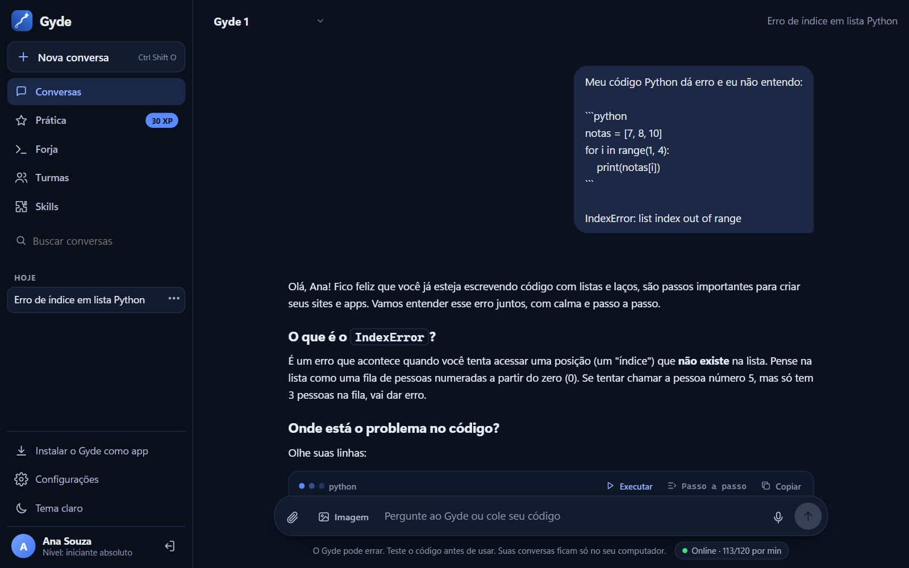
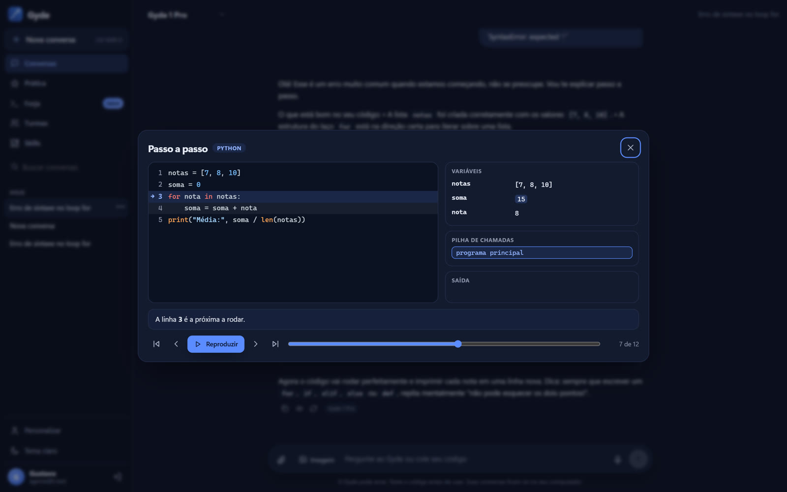
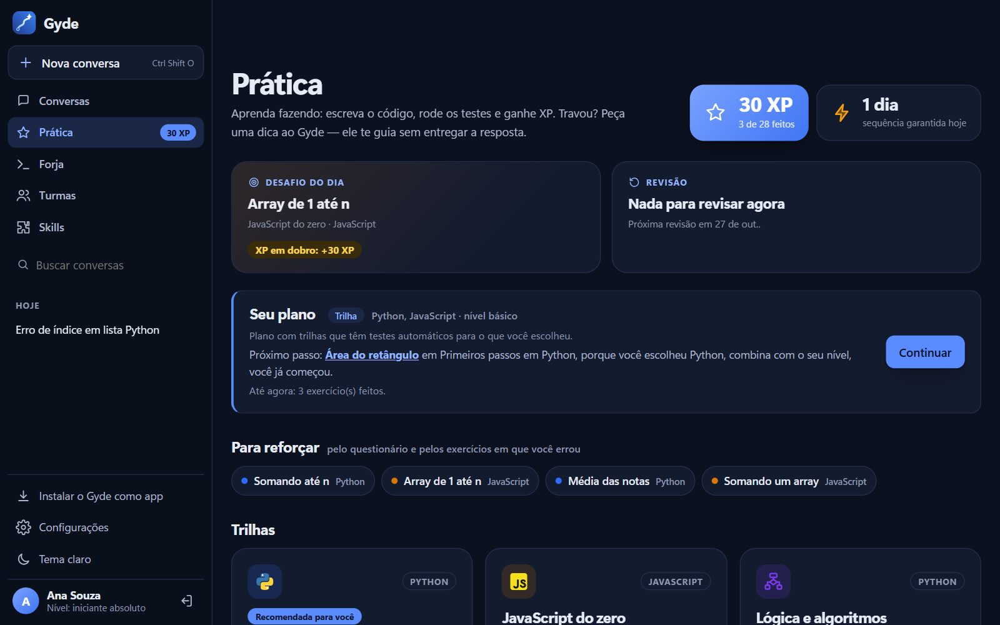
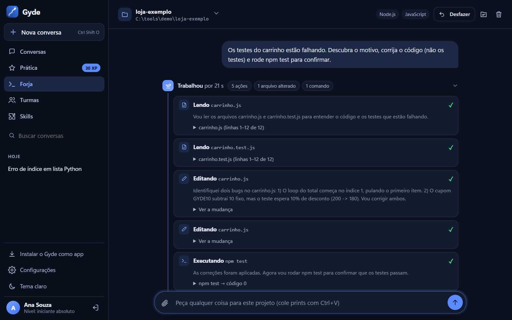
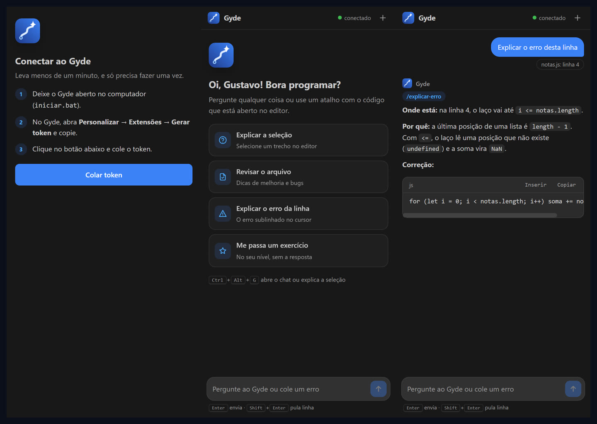
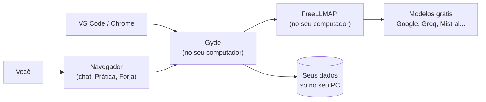
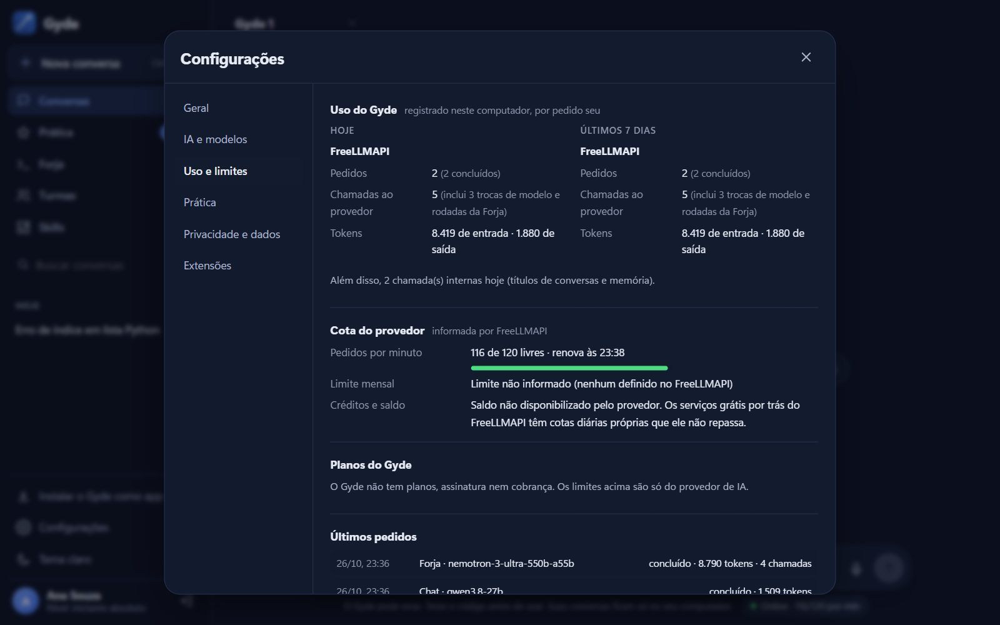

<p align="center">
  
</p>

<h3 align="center">O tutor de programação com IA que ensina em vez de só entregar a resposta.</h3>

<p align="center">
  Chat que explica o erro antes de corrigir · agente que programa sozinho no seu projeto · prática com XP ·
  extensões para VS Code e Chrome. Em português, de graça, rodando no seu computador.
</p>

<p align="center">
  
  
  
  
  
</p>

<p align="center">
  <a href="COMO-INSTALAR.md"><b>Instalar (passo a passo)</b></a> ·
  <a href="#o-que-o-gyde-faz">O que ele faz</a> ·
  <a href="#forja-o-agente-de-c%C3%B3digo">Forja</a> ·
  <a href="#uso-cotas-e-limites">Uso e limites</a> ·
  <a href="#configura%C3%A7%C3%A3o-env">Configuração</a> ·
  <a href="#testes">Testes</a> ·
  <a href="#perguntas-frequentes">Dúvidas</a>
</p>

---

## Por que o Gyde existe

Quem está começando a programar trava num erro, cola numa IA, recebe o código pronto e... não aprende nada.
O **Gyde** foi feito para o contrário: ele **mostra onde está o erro, explica o porquê e só depois corrige**,
no nível de quem está aprendendo. E quando você já sabe o que quer, a **Forja** (o agente de código do Gyde)
abre o seu projeto e faz o trabalho sozinha, como um desenvolvedor: escreve, testa, corrige e documenta.

Tudo roda **no seu computador**, com os modelos de IA **grátis** do [FreeLLMAPI](https://github.com/tashfeenahmed/freellmapi).
Suas conversas e seu progresso ficam só com você.

## O que o Gyde faz

### Chat de tutor
Cole um erro ou um código. O Gyde aponta a linha, explica a causa e mostra a correção. Os blocos de Python e
JavaScript têm o botão **Executar**, que roda o código ali mesmo.

<p align="center"></p>

### Passo a passo
O botão **Passo a passo** roda o código linha por linha e mostra o valor de cada variável a cada passo.
É o jeito mais fácil de entender um laço ou uma função.

<p align="center"></p>

### Prática personalizada
Trilhas de Python, JavaScript e lógica, **projetos guiados** com testes automáticos, **XP**, **desafio do dia**,
**sequência de dias** e **revisão dos erros** (o exercício que você errou volta depois de 1, 3, 7 e 21 dias).
Travou? A **Dica do Gyde** ajuda sem entregar a resposta.

Cada conta tem o próprio plano, montado a partir de três fontes que a tela mostra separadas:
- **o que você respondeu** no questionário inicial (linguagens, objetivo, experiência, jeito de aprender);
- **o que o mini desafio mediu** (nível e assuntos para reforçar);
- **o que os exercícios mostram** (feitos, tentativas com erro, onde você travou).

Qualquer combinação de respostas gera um plano, sem depender de IA, e a tela diz qual dos quatro tipos ele é:

| Tipo | Quando | O que você recebe |
|---|---|---|
| **Trilha** | Existe trilha com testes automáticos para o que você escolheu (Python, JavaScript, lógica) | Exercícios corrigidos na hora, no navegador |
| **Plano adaptado** | Parte tem trilha e parte não (ex.: HTML e CSS) | Trilhas com testes + exercícios guiados |
| **Plano montado** | Não há trilha (Java, C / C++, C#, PHP, SQL, Kotlin) | Exercícios guiados da tecnologia, no seu nível |
| **Plano inicial** | Sem questionário ou sem escolhas | Lógica e Python do básico, até você responder |

**Exercícios guiados** vêm de um catálogo local (10 tecnologias, 3 níveis): você resolve no seu editor, clica em
**Resolver no chat** e o Gyde corrige sem entregar a resposta; depois, **Marcar como feito**. Eles não têm teste
automático, e a tela diz isso. Quem nunca programou não recebe exercício avançado, e quem já é avançado não precisa
refazer o básico. Quando tudo do plano acaba, aparece um novo desafio em vez de uma tela vazia. Refazer o questionário
atualiza o plano sem apagar XP, exercícios feitos nem a sequência de dias.

<p align="center"></p>

### Forja, o agente de código
O chat do Gyde com acesso a uma pasta do seu computador. A conversa funciona como no chat principal. A diferença
é que a Forja **trabalha nos arquivos de verdade**: lê o código, cria e edita arquivos, roda os testes até passarem
e documenta. Você não precisa saber comandos de terminal.

1. Abra a Forja e escreva o pedido (ou clique em **Conectar pasta do projeto**). A janela do Windows abre para você
   escolher a pasta; o servidor do Gyde, que roda no mesmo PC, passa a ter acesso só a ela.
2. A Forja identifica o projeto (tecnologias, quantidade de arquivos, comando de testes) e mostra isso no topo.
3. Cada ação aparece ao vivo (lendo, editando, executando), com o tempo que levou e as mudanças coloridas.
4. No fim vem um resumo, montado pelo servidor e não pelo texto da IA, com os arquivos **criados, alterados e
   apagados** e os **comandos rodados** com o resultado.
5. Continue a conversa: o contexto do projeto e das mensagens anteriores fica guardado.

- **Desfazer:** o botão **Desfazer** (ou pedir "desfaça a última alteração") volta os arquivos ao que eram antes da
  última tarefa. Arquivos que você editou depois ficam como estão, e a Forja avisa quais.
- **Trocar de projeto:** o nome da pasta no topo abre o menu com outra pasta e os projetos recentes.
- **Pasta guardada:** a conversa lembra a pasta mesmo depois de fechar o Gyde ou reiniciar o PC. Se a pasta sumir, a
  Forja diz o motivo real (movida ou apagada, unidade desconectada, sem permissão) e o botão **Reconectar pasta**
  aponta a conversa para o novo lugar, mantendo o histórico.
- **Anexos:** prints de erro, referências de layout ou arquivos de texto (clipe, Ctrl+V ou arrastar).
  As imagens vão para um modelo que enxerga.
- **Arquivos do projeto:** o botão de pasta no topo mostra tudo o que a Forja pode ver.

<p align="center"></p>

**Segurança da Forja** (no código, não só nas instruções da IA):
- só mexe dentro da pasta escolhida, nem por `..`, caminho absoluto ou atalho que aponte para fora;
- nunca lê, envia ao modelo, edita ou apaga arquivos de senhas e chaves (`.env`, chaves SSH, `.pem`, `credentials`...);
- chaves e tokens que aparecerem em arquivos ou saídas viram `[segredo removido]` antes de ir para a IA e para a tela;
- os comandos não recebem as chaves do Gyde;
- comandos são classificados: os perigosos (formatar, desligar, mexer no sistema, ler senhas) são **bloqueados**;
  apagar arquivos, instalar pacotes, acessar a internet, mexer no Git remoto ou publicar **pedem a sua autorização**;
- botão **Parar** a qualquer momento (também encerra os comandos em andamento);
- a cópia dos arquivos usada pelo **Desfazer** fica só no banco local e nunca vai para a IA.

### Configurações
No menu lateral, **Configurações** reúne tudo em seções: **Geral** (tema automático, claro ou escuro; página inicial;
vídeo de abertura; restaurar padrões), **IA e modelos** (estado real da conexão, modo online, offline ou automático,
como o Gyde deve responder, memória), **Uso e limites**, **Prática** (suas respostas, nível medido e desempenho;
refazer o questionário), **Privacidade e dados** (o que fica no PC, o que vai para a IA, apagar conversas e registros)
e **Extensões** (tokens). Cada opção salva na hora.

### E mais
- **Skills:** habilidades instaláveis, como plugins (`/revisar`, `/git`, `/sql`...). Dá para criar as suas e publicar na loja de skills.
- **Questionário inicial:** o Gyde descobre o seu nível e objetivo e adapta as explicações e a Prática.
- **Turmas:** o professor cria a turma, passa exercícios com prazo e acompanha quem fez.
- **Memória:** o Gyde lembra o que você pedir para ele lembrar (dá para ver e apagar).
- **Revisar projeto inteiro:** anexe uma pasta ou um `.zip` e peça a revisão.
- **Imagens e voz:** gera imagens e lê as respostas em voz alta.
- **App:** instale pelo navegador como um aplicativo. Tema claro e escuro.
- **Vídeo de abertura** em 3D, com narração e legendas.

## Extensões

### VS Code
O Gyde dentro do editor: chat na barra lateral e, com o botão direito, **Explicar com o Gyde**,
**Revisar com o Gyde** e **Explicar o erro desta linha**. A resposta tem o botão **Inserir no editor**.
Veja [extensoes/vscode](extensoes/vscode/README.md).

<p align="center"></p>

### Chrome
Painel lateral que lê a página, a seleção ou um print, e um **modo agente**: você dá o comando e ele faz sozinho
na aba, com uma seta que clica e digita (e para antes de compras, exclusões e senhas).
Veja [extensoes/chrome](extensoes/chrome/LEIA-ME.md).

## Como funciona



O Gyde tenta uma fila de modelos bons para programar. Se um estiver ocupado ou fora do ar, o próximo assume.
Cada resposta mostra, embaixo, o **modelo que respondeu de verdade** (os nomes do FreeLLMAPI são apelidos: o
"claude-sonnet-4-5" de lá, por exemplo, foi atendido pelo Qwen nos testes) e os tokens usados.

## Uso, cotas e limites

Em **Configurações > Uso e limites** (ou clicando no indicador do rodapé do chat), cada conceito aparece separado:

| O quê | O que é | De onde vem |
|---|---|---|
| **Uso do Gyde** | Pedidos seus (mensagem do chat, tarefa da Forja, dica da Prática), hoje e nos últimos 7 dias, separados em concluídos, com falha, cancelados e barrados por limite | Registro do próprio Gyde, no banco local (`uso.js`) |
| **Chamadas** | Quantas vezes o Gyde falou com o provedor. Trocas de modelo e rodadas da Forja geram várias chamadas num pedido, e o pedido conta uma vez só | Registro do Gyde |
| **Tokens** | Entrada e saída do modelo | Campo `usage` da resposta do provedor. Se ele não manda, aparece "não informado", nunca estimado |
| **Cota do provedor** | Pedidos por minuto livres e a hora em que renova; consumo do mês na conta do FreeLLMAPI | Cabeçalhos `x-ratelimit-*` e a rota `/v1/usage` do FreeLLMAPI |
| **Créditos e saldo** | Não existe no FreeLLMAPI | Aparece "Saldo não disponibilizado pelo provedor" |
| **Planos do Gyde** | Não existem: o Gyde não tem assinatura nem cobrança | — |

Provedores diferentes (FreeLLMAPI e modelo local) aparecem separados, porque as cotas não se somam.

<p align="center"></p>

**Quando o limite acaba**, a mensagem diz qual limite foi (os pedidos por minuto do FreeLLMAPI), quando ele renova
(se o FreeLLMAPI informou) e o que funciona enquanto isso (o modelo local, se estiver instalado). No modo automático,
se o FreeLLMAPI parar de responder, o Gyde usa o modelo local e **avisa** na resposta, sem troca silenciosa.

O FreeLLMAPI não informa a cota diária de cada serviço grátis que ele usa por trás (Google, Groq...), então o Gyde
também não mostra isso.

## IA offline (sem internet)

O Gyde pode usar um modelo que roda no seu computador pelo [Ollama](https://ollama.com), sem mandar nada para fora.

1. Instale o Ollama e baixe um modelo pequeno (o download é seu, de uns 2 GB): `ollama pull qwen2.5:3b`
2. Em **Configurações > IA e modelos**, escolha **Só offline**, ou deixe em **Automático** (usa o offline se o FreeLLMAPI cair).

| Funciona sem internet | Funciona offline depois de instalar o Ollama e baixar um modelo | Precisa de internet |
|---|---|---|
| App, contas, histórico, Prática (editor e testes), rodar código e passo a passo, skills, turmas, memória salva | Chat, Forja, dicas da Prática e títulos de conversa (com o modelo local) | Modelos online (FreeLLMAPI), gerar imagens (Cloudflare), voz natural (Gemini), extensão do Chrome no modo agente |

Modelos locais pequenos são bem mais simples e lentos que os online, principalmente em tarefas grandes de programação.
Num computador com 8 GB de RAM e sem placa de vídeo, use modelos de até 3 bilhões de parâmetros.

## Instalar

**Siga o [COMO-INSTALAR.md](COMO-INSTALAR.md)**: o passo a passo completo, feito para quem nunca instalou nada
parecido. Leva uns 15 minutos.

Resumo:

1. Baixe este repositório (**Code → Download ZIP**) e extraia numa pasta fixa.
2. Instale o [FreeLLMAPI](https://github.com/tashfeenahmed/freellmapi/releases/latest) e coloque pelo menos uma chave grátis (ex.: Google AI Studio).
3. Dê dois cliques em **`instalar.bat`**.
4. Use o **`iniciar.bat`** sempre que quiser abrir o Gyde. Ele roda em http://127.0.0.1:3210.

> Cada pessoa tem o próprio Gyde: a conta, as conversas e o progresso ficam no computador de quem instalou,
> e cada um usa as próprias chaves grátis de IA.

## Configuração (.env)

O `instalar.bat` e os scripts da pasta `configurar/` criam o `.env` para você. Se quiser editar à mão, ele fica na
pasta principal do Gyde e **nunca vai para o GitHub**. Exemplo (sem chaves de verdade):

```ini
# obrigatório para os modelos online
FREELLMAPI_URL=http://127.0.0.1:31415
FREELLMAPI_KEY=cole-aqui-a-chave-do-freellmapi

# opcionais
PORT=3210                      # porta do Gyde
GYDE_MODO_IA=auto              # auto | online | offline
OLLAMA_URL=http://127.0.0.1:11434
OLLAMA_MODELO=qwen2.5:3b
CLOUDFLARE_ACCOUNT_ID=         # gerar imagens (configurar\configurar-imagens.bat)
CLOUDFLARE_API_TOKEN=
GEMINI_API_KEY=                # voz natural (configurar\configurar-voz.bat)
```

Para rodar sem os `.bat`: `npm install` e depois `npm start` (Node.js 22.13 ou mais novo).

### Atualizar o Gyde

Baixe a versão nova (ou `git pull`) e **feche e abra de novo o `iniciar.bat`**. O servidor só lê o código quando
inicia; se ele continuar aberto, a tela avisa: "O Gyde foi atualizado, mas o servidor ainda está rodando a versão
anterior". Suas contas, conversas e progresso ficam na pasta `data/` e não são tocados.

## Testes

```bash
npm test
```

Roda os testes automáticos de `app/testes/` (19 testes, sem internet e sem gastar cota):
- **segurança:** caminhos fora da pasta, arquivos de senha, classificação de comandos, remoção de segredos;
- **uso:** pedidos x chamadas, tokens só quando informados, cancelados e limite por minuto (com um provedor falso local);
- **Prática:** mais de 10 mil combinações das alternativas reais do questionário, cada linguagem, níveis, respostas
  inválidas ou faltando, progresso parcial e completo. A regra testada: toda resposta válida vira um plano com próximo
  passo (ou um novo desafio), sem chamar IA.

## Limitações conhecidas

- Os modelos grátis variam: às vezes um modelo recusa uma tarefa sozinho ou pergunta em vez de agir. O Gyde troca
  de modelo quando a resposta vem vazia ou inválida, mas não dá para garantir o mesmo comportamento sempre.
- O modelo local (Ollama) é bem mais simples e lento que os online, principalmente na Forja.
- O **Desfazer** da Forja guarda as 10 últimas tarefas de cada conversa e não copia arquivos maiores que 2 MB.
- Exercícios guiados (Java, SQL, C#...) não têm correção automática: dependem do chat e de você marcar como feito.
- A Forja e a janela de escolher pasta só funcionam no Windows e com o Gyde no modo pessoal (rodando no seu PC).
- A moderação depende das instruções do Gyde e do provedor; não há um filtro de conteúdo separado.
- Imagens geradas ficam acessíveis para qualquer conta logada no mesmo Gyde que tenha o link (os nomes são aleatórios).

## Contribuir

Ideias e correções são bem-vindas. Abra uma [issue](https://github.com/gustavomdeschamps/Gyde/issues) descrevendo
o problema ou a ideia; para mudanças de código, faça um fork, rode `npm test` e abra um pull request explicando o que
mudou. Nunca inclua o `.env`, a pasta `data/` ou chaves nos commits.

## Perguntas frequentes

**É grátis mesmo?**
Sim. O Gyde é grátis e usa os limites grátis dos serviços de IA (Google, Groq, Mistral e outros) pelo FreeLLMAPI.

**Precisa de internet?**
Para os modelos online, sim. Sem internet, dá para usar um modelo local pelo Ollama (veja "IA offline").

**Meus dados vão para algum lugar?**
Sua conta, conversas e progresso ficam na pasta `data` do seu computador. As mensagens vão só para o serviço de IA
que responde.

**E quando o limite grátis acabar?**
O FreeLLMAPI troca de serviço quando um deles esgota. Se acabar o limite por minuto do próprio FreeLLMAPI, o Gyde
diz quando renova e, se você tiver o Ollama, oferece o modelo local. Veja em **Configurações > Uso e limites**.

**Funciona no Mac ou no Linux?**
Foi feito e testado no Windows. O servidor é Node.js e roda em outros sistemas, mas os instaladores e a janela de
escolher pasta da Forja são do Windows.

## Estrutura do projeto

| Pasta ou arquivo | Para que serve |
|---|---|
| `instalar.bat` | Instala tudo na primeira vez |
| `iniciar.bat` | Abre o Gyde no dia a dia |
| `COMO-INSTALAR.md` | Passo a passo de instalação |
| `configurar/` | Extras: chave do FreeLLMAPI, imagens, voz, e-mail, trocar senha, extensão do VS Code |
| `extensoes/` | Extensões para VS Code (`vscode/`) e Chrome (`chrome/`) |
| `app/` | O programa: servidor (`server.js`), Forja (`codigo-agente.js`), provedores online/offline (`provedores.js`), registro de uso (`uso.js`), proteções (`seguranca.js`), modelos (`motor.js`), Prática (`pratica-servidor.js`), interface (`public/`), skills (`skills-catalogo/`) e testes (`testes/`) |
| `docs/` | Imagens desta página |

Arquivos criados no seu computador e que **nunca** vão para o GitHub: `.env` (suas chaves) e `data/` (contas e conversas).

Esqueceu a senha? Rode `configurar\redefinir-senha.bat`.

O Gyde foi feito para rodar no seu próprio computador: o servidor só aceita conexões do próprio PC (127.0.0.1).

## Sobre

**Gyde** (Gustavo + Yasmin + Deschamps, e soa como *guide*, "guia") foi criado por
**Gustavo Moreira Deschamps**, estudante de Desenvolvimento de Sistemas na Escola SESI SENAI Blumenau.

Achou um problema ou tem uma ideia? Abra uma [issue](https://github.com/gustavomdeschamps/Gyde/issues).

Licença [MIT](LICENSE): use, estude, modifique e compartilhe, mantendo os créditos.
