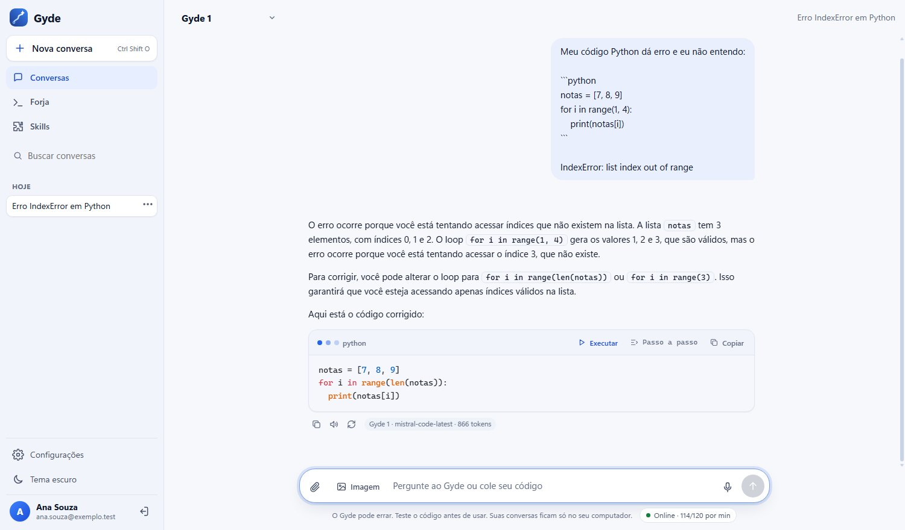
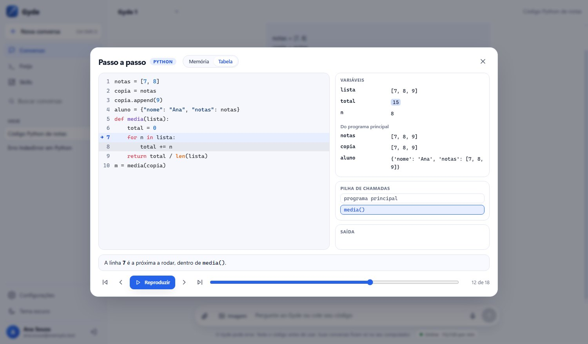
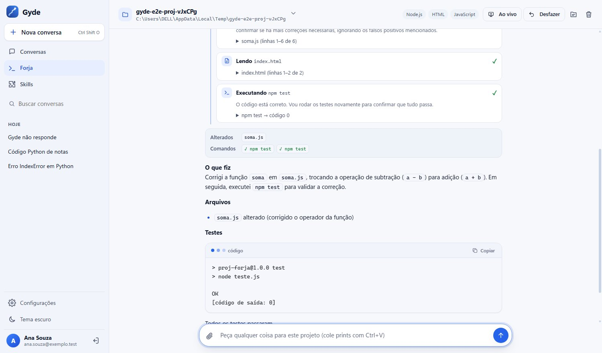
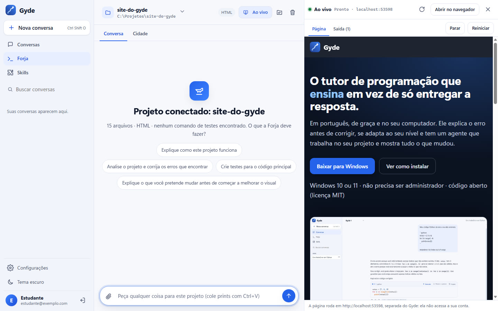
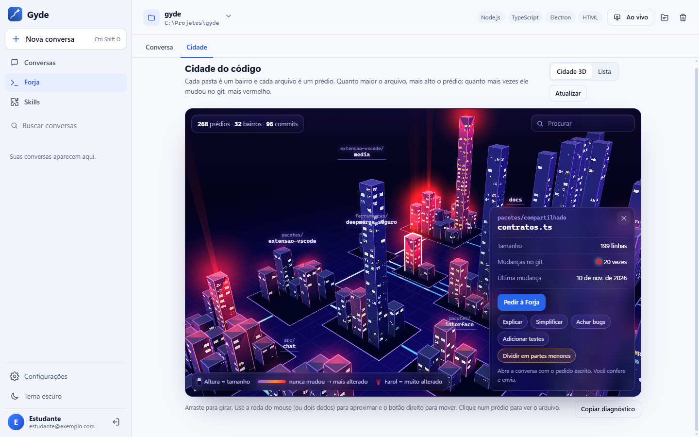
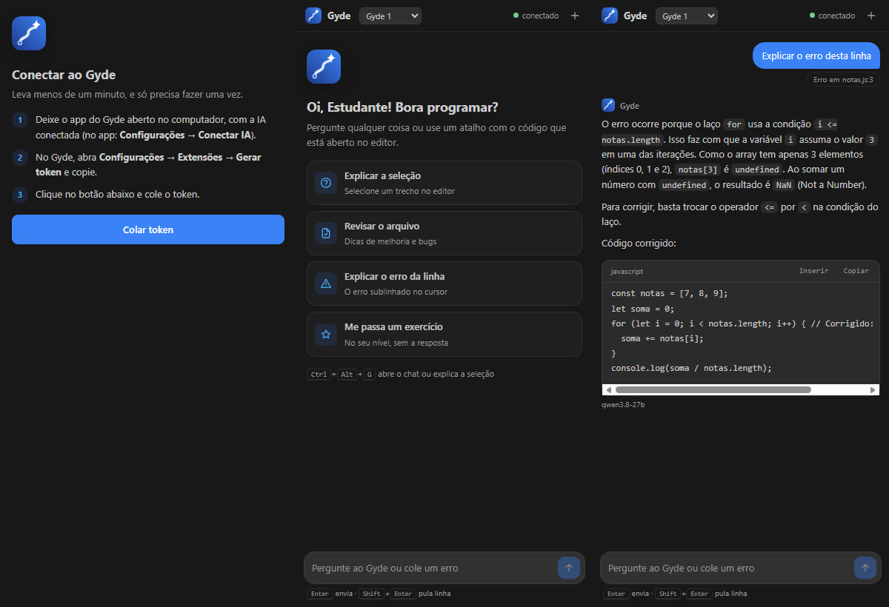
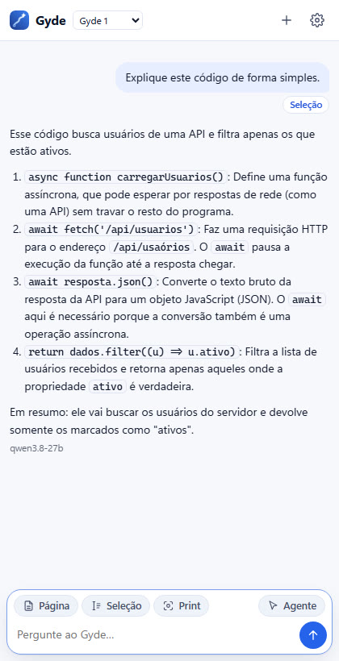
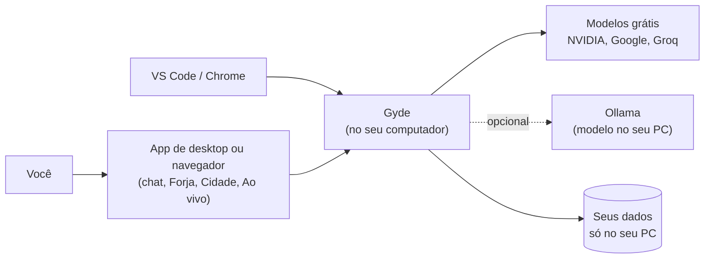
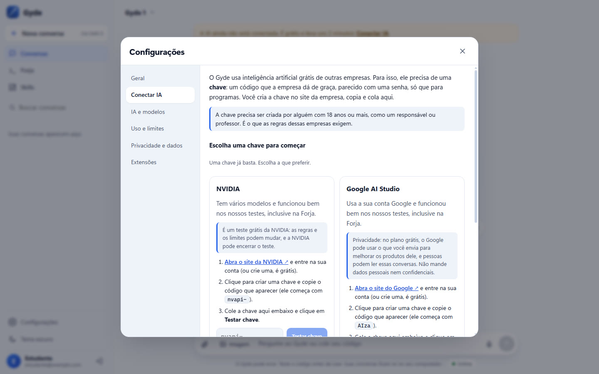

<p align="center">
  
</p>

<h3 align="center">O tutor de programação com IA que ensina em vez de só entregar a resposta.</h3>

<p align="center">
  Chat que explica o erro antes de corrigir · agente que programa sozinho no seu projeto · o projeto ligado ao vivo e
  visto como uma cidade em 3D · app de desktop e extensões para VS Code e Chrome. Em português, de graça, rodando no seu computador.
</p>

<p align="center">
  
  
  
  
  
</p>

<p align="center">
  <a href="COMO-INSTALAR.md"><b>Instalar (passo a passo)</b></a> ·
  <a href="#o-que-o-gyde-faz">O que ele faz</a> ·
  <a href="#forja-o-agente-de-c%C3%B3digo">Forja</a> ·
  <a href="#conectar-a-ia">Conectar a IA</a> ·
  <a href="#configura%C3%A7%C3%A3o-env">Configuração</a> ·
  <a href="#testes">Testes</a> ·
  <a href="#perguntas-frequentes">Dúvidas</a>
</p>

---

## Por que o Gyde existe

Quem está começando a programar trava num erro, cola numa IA, recebe o código pronto e... não aprende nada.
O **Gyde** foi feito para o contrário: ele **mostra onde está o erro, explica o porquê e só depois corrige**,
no nível de quem está aprendendo. E quando você já sabe o que quer, a **Forja** (o agente de código do Gyde)
abre o seu projeto e faz o trabalho sozinha, como um desenvolvedor: escreve, testa, corrige e documenta.

O app roda **no seu computador** e usa os modelos de IA **grátis** da NVIDIA ou do Google, com uma chave que você
cria em 2 minutos. Suas conversas ficam só com você; só a pergunta vai para o serviço de IA que responde.

## O que o Gyde faz

### Chat de tutor
Cole um erro ou um código. O Gyde aponta a linha, explica a causa e mostra a correção. Os blocos de Python e
JavaScript têm o botão **Executar**, que roda o código ali mesmo.

<p align="center"><picture><source media="(prefers-color-scheme: dark)" srcset="docs/imagens/chat-escuro.jpg"></picture></p>

### Passo a passo
O botão **Passo a passo** roda o código linha por linha e mostra o valor de cada variável a cada passo.
É o jeito mais fácil de entender um laço ou uma função.

<p align="center"></p>

### Forja, o agente de código
O chat do Gyde com acesso a uma pasta do seu computador. A conversa funciona como no chat principal. A diferença
é que a Forja **trabalha nos arquivos de verdade**: lê o código, cria e edita arquivos, roda os testes até passarem
e documenta. Você não precisa saber comandos de terminal.

1. Abra a Forja e escreva o pedido (ou clique em **Conectar pasta do projeto**). A janela do Windows abre para você
   escolher a pasta (no app de desktop, a janela nativa); o servidor do Gyde, que roda no mesmo PC, passa a ter acesso só a ela.
2. A Forja identifica o projeto (tecnologias, quantidade de arquivos, comando de testes) e mostra isso no topo.
3. Cada ação aparece ao vivo (lendo, editando, executando), com o tempo que levou e as mudanças coloridas.
4. No fim vem um resumo, montado pelo servidor e não pelo texto da IA, com os arquivos **criados, alterados e
   apagados** e os **comandos rodados** com o resultado.
5. Continue a conversa: o contexto do projeto e das mensagens anteriores fica guardado.

- **Desfazer:** o botão **Desfazer** (ou pedir "desfaça a última alteração") volta os arquivos ao que eram antes da
  última tarefa. Arquivos que você editou depois ficam como estão, e a Forja avisa quais.
- **Trocar de projeto:** o nome da pasta no topo abre o menu com outra pasta e os projetos recentes.
- **Pasta guardada:** a conversa lembra a pasta mesmo depois de fechar o Gyde ou reiniciar o PC. Se a pasta sumir, a
  Forja diz o motivo real (movida ou apagada, unidade desconectada, sem permissão) e o botão **Reconectar pasta**
  aponta a conversa para o novo lugar, mantendo o histórico.
- **Anexos:** prints de erro, referências de layout ou arquivos de texto (clipe, Ctrl+V ou arrastar).
  As imagens vão para um modelo que enxerga.
- **Arquivos do projeto:** o botão de pasta no topo mostra tudo o que a Forja pode ver.

<p align="center"><picture><source media="(prefers-color-scheme: dark)" srcset="docs/imagens/forja-escuro.jpg"></picture></p>

**Segurança da Forja** (no código, não só nas instruções da IA):
- só mexe dentro da pasta escolhida, nem por `..`, caminho absoluto ou atalho que aponte para fora;
- nunca lê, envia ao modelo, edita ou apaga arquivos de senhas e chaves (`.env`, chaves SSH, `.pem`, `credentials`...);
- chaves e tokens que aparecerem em arquivos ou saídas viram `[segredo removido]` antes de ir para a IA e para a tela;
- os comandos não recebem as chaves do Gyde;
- comandos são classificados: os perigosos (formatar, desligar, mexer no sistema, ler senhas) são **bloqueados**;
  apagar arquivos, instalar pacotes, acessar a internet, mexer no Git remoto ou publicar **pedem a sua autorização**;
- botão **Parar** a qualquer momento (também encerra os comandos em andamento);
- a cópia dos arquivos usada pelo **Desfazer** fica só no banco local e nunca vai para a IA.

### Ao vivo: o seu projeto ligado
O botão **Ao vivo**, no topo da Forja, liga o projeto da pasta conectada e mostra ao lado da conversa:
- o Gyde descobre como ligar o projeto (React, Vue, Vite, Next, Nuxt, Astro, Angular, site de HTML, Python, Java, C#,
  Go, Rust) e mostra o **comando exato**; nada roda antes do seu clique;
- projetos web abrem dentro do Gyde, só no próprio computador (127.0.0.1) e numa porta livre; uma pasta de build
  pronta é servida com a raiz certa; programas de console mostram a saída ao vivo;
- erros vêm explicados em português, com o botão **Pedir à Forja para consertar**;
- o projeto **não recebe as chaves do Gyde**, e comandos perigosos são bloqueados;
- fechar o painel ou o Gyde encerra tudo o que o Ao vivo ligou; se o Gyde for fechado à força, o que sobrou é
  encerrado na próxima abertura.

<p align="center"><picture><source media="(prefers-color-scheme: dark)" srcset="docs/imagens/ao-vivo-escuro.jpg"></picture></p>

### Cidade do código
Na Forja, a aba **Cidade** mostra a pasta conectada como uma cidade em 3D: cada pasta é um bairro, cada arquivo um
prédio. Quanto maior o arquivo, mais alto o prédio; quanto mais ele mudou no git, mais quente a cor; os mais alterados
ganham um farol. Quando a Forja lê, edita, cria ou apaga um arquivo, o prédio acende na hora. Clique num prédio para ver
o arquivo. Prefere texto? O botão **Lista** mostra o mesmo em forma acessível.

**Pedir à Forja pela Cidade:** o cartão do prédio tem **Pedir à Forja** ("Analise o arquivo X e sugira melhorias") e
opções rápidas: explicar, simplificar, achar bugs e adicionar testes. Nos faróis aparece também **dividir em partes
menores**. O pedido é só escrito no campo da Forja; quem envia é você. A cidade continua reagindo enquanto a Forja trabalha.

Roda em placa de vídeo integrada (desenha direto na tela). Os extras, como o brilho (bloom), só ligam sozinhos em placa
dedicada e depois de uma checagem de segurança. O botão **Copiar diagnóstico** junta a placa de vídeo, as checagens e
os tempos de quadro, sem dados pessoais, para relatar um problema.

<p align="center"><picture><source media="(prefers-color-scheme: dark)" srcset="docs/imagens/cidade-forja.jpg"></picture></p>

### Configurações
No menu lateral, **Configurações** reúne tudo em seções: **Geral** (tema automático, claro ou escuro; página inicial;
refazer o questionário; vídeo de abertura; restaurar padrões; copiar um relatório de erro), **Conectar IA** (as chaves
grátis), **IA e modelos** (geração de imagens, modo online, offline ou automático, como o Gyde deve responder, memória),
**Uso e limites**, **Privacidade e dados** (o que fica no PC, o que vai para a IA, cópia de segurança para baixar e
restaurar, apagar conversas e registros) e **Extensões** (tokens). Cada opção salva na hora.

### E mais
- **Skills:** habilidades instaláveis, como plugins (`/revisar`, `/git`, `/sql`...). Dá para criar as suas e publicar na loja de skills.
- **Questionário inicial:** o Gyde descobre o seu nível e objetivo e adapta as explicações e os exemplos.
- **Memória:** o Gyde lembra o que você pedir para ele lembrar (dá para ver e apagar).
- **Revisar projeto inteiro:** anexe uma pasta ou um `.zip` e peça a revisão.
- **Imagens e voz:** gera imagens (Cloudflare, ligado em Configurações > IA) e lê as respostas em voz alta com a voz do Windows.
- **App de desktop:** janela própria (Electron), uma instância só, seletor de pasta nativo, registro de diagnóstico e atualização pelo GitHub. Tema claro e escuro.
- **Vídeo de abertura** em 3D, com narração e legendas.

## Extensões

### VS Code
O Gyde dentro do editor: chat na barra lateral e, com o botão direito, **Explicar com o Gyde**,
**Revisar com o Gyde** e **Explicar o erro desta linha**. A resposta tem o botão **Inserir no editor**. No topo,
**Gyde 1** ou **Gyde 1 Pro**; embaixo de cada resposta, o modelo que respondeu. **Gyde: Pedir à Forja** (botão
direito num arquivo) deixa um pedido no app: ele aparece num cartão e só vira tarefa quando você abre a Forja e envia.
Veja [pacotes/extensao-vscode](pacotes/extensao-vscode/README.md).

<p align="center"></p>

### Chrome
Painel lateral que lê a página, a seleção ou um print, e um **modo agente**: você dá o comando e ele faz sozinho
na aba, com uma seta que clica e digita (e para antes de compras, exclusões e senhas).
Veja [pacotes/extensao-chrome](pacotes/extensao-chrome/LEIA-ME.md).

<p align="center"></p>

As duas usam o app do Gyde aberto e a IA conectada nele. Ao abrir, o painel já avisa se a IA do app não está
conectada ou se o app está numa versão mais antiga que a extensão. O token só serve para conversar e para deixar um
pedido para a Forja: com ele, as extensões não leem nem mudam as suas chaves, as configurações ou os seus dados, e não
rodam nada no seu projeto.

## Como funciona



No chat, você escolhe entre duas opções:
- **Gyde 1:** escolhe sozinho um modelo grátis para cada pedido e troca se um falhar.
- **Gyde 1 Pro:** um segundo modelo confere a resposta. Mais lento e usa mais da sua cota grátis.

Por trás, o Gyde lê cada pedido e escolhe o modelo que foi melhor naquele tipo de tarefa nas
[avaliações](docs/avaliacao/README.md), usando a lista de modelos ao vivo de cada provedor, e troca sozinho se ele
falhar ou estiver no limite. Quem responde é sempre o Gyde: mesmas instruções, mesma memória, mesma voz. Embaixo de
cada resposta aparece o **modelo que respondeu de verdade**. Como isso funciona e como adicionar modelos:
[docs/inteligencia.md](docs/inteligencia.md).

**Por dentro:** tudo em TypeScript estrito. O servidor é Node.js com Express e o SQLite que já vem no Node, com o
esquema do banco em migrações numeradas (cópia do banco antes de cada atualização). A interface é Svelte 5 com Vite.
Servidor e interface conferem cada resposta pelos mesmos contratos (Zod), então uma tela nunca recebe um formato que
não espera sem avisar. O app de desktop é Electron: sobe o servidor num processo separado e abre a interface.

## Avaliação da IA

A escolha dos modelos vem de chamadas reais, corrigidas automaticamente (código rodando contra testes, SQL num banco de
verdade, arquivos conferidos no disco), em 17 categorias. Nas medições de 09/11/2026, com as chaves grátis ligadas
direto, o melhor modelo no chat acertou 44 de 48 tarefas, e a Forja (NVIDIA + Groq) completou 7 de 8 cenários. Resumo
e dados brutos em [docs/avaliacao](docs/avaliacao/README.md). Amostras pequenas: servem para comparar, não como
garantia, e não há comparação com outros produtos.

## Conectar a IA

Em **Configurações > Conectar IA**, cole uma chave grátis da **NVIDIA** ou do **Google** (uma basta). O Gyde testa a
chave na hora, com uma chamada de verdade, antes de salvar, e ela nunca volta para a tela. O passo a passo para criar a
chave está no [COMO-INSTALAR.md](COMO-INSTALAR.md#4-conectar-a-ia-2-minutos).

<p align="center"><picture><source media="(prefers-color-scheme: dark)" srcset="docs/imagens/conectar-ia-escuro.jpg"></picture></p>

- A chave precisa ser criada por alguém com **18 anos ou mais** (regra dessas empresas).
- No plano grátis do Google, o que você envia pode ser usado para melhorar os produtos dele: não mande dados pessoais.
- O teste grátis da NVIDIA pode mudar as regras e os limites.
- **Groq** é opcional: deixa o chat mais rápido e serve de reserva.
- Quem já usa o **[FreeLLMAPI](https://github.com/tashfeenahmed/freellmapi)** continua podendo usar, em **Conectar IA > Avançado**.

**Limites:** cada serviço grátis tem o próprio limite e pode mudar sem aviso. Quando um modelo chega ao limite, o Gyde
troca de modelo sozinho. Em **Configurações > Uso e limites** aparecem os seus pedidos, as chamadas aos provedores e os
tokens (só quando o provedor informa, nunca estimados). O Gyde não tem planos, assinatura nem cobrança.

## IA offline (sem internet)

O Gyde pode usar um modelo que roda no seu computador pelo [Ollama](https://ollama.com), sem mandar nada para fora.

1. Instale o Ollama e baixe um modelo pequeno (o download é seu, de uns 2 GB): `ollama pull qwen2.5:3b`
2. Em **Configurações > IA e modelos**, escolha **Só offline**, ou deixe em **Automático** (usa o offline se os modelos online falharem).

| Funciona sem internet | Funciona offline depois de instalar o Ollama e baixar um modelo | Precisa de internet |
|---|---|---|
| App, contas, histórico, rodar código e passo a passo, skills, memória salva | Chat, Forja e títulos de conversa (com o modelo local) | Modelos online (NVIDIA, Google, Groq), gerar imagens (Cloudflare), extensão do Chrome no modo agente |

Modelos locais pequenos são bem mais simples e lentos que os online, principalmente em tarefas grandes de programação.
Num computador com 8 GB de RAM e sem placa de vídeo, use modelos de até 3 bilhões de parâmetros.

## Instalar

**Siga o [COMO-INSTALAR.md](COMO-INSTALAR.md)**: o passo a passo completo, com as telas, feito para quem nunca
instalou nada parecido.

Resumo:

1. Na página **[Releases](https://github.com/gustavomdeschamps/Gyde/releases/latest)**, baixe o **`Gyde-Setup-<versão>.exe`**.
2. Abra e siga as telas: **Apenas para mim** → **Próximo** → **Instalar** → **Concluir**. Não precisa ser
   administrador, nem instalar Node.js ou outra coisa antes.
3. O Gyde abre numa janela própria. Crie a conta (fica só no seu computador) e responda o questionário.
4. Em **Configurações > Conectar IA**, cole uma chave grátis da NVIDIA ou do Google.

O instalador não tem assinatura digital paga, então o Windows pode mostrar o aviso do SmartScreen (**Mais
informações** > **Executar assim mesmo**, se você baixou daqui). Os dados e o `.env` ficam em `%APPDATA%\Gyde`;
atualizar mantém tudo, e desinstalar pergunta antes de apagar os seus dados.

> Cada pessoa tem o próprio Gyde: a conta e as conversas ficam no computador de quem instalou, e cada um usa as
> próprias chaves grátis de IA.

## Configuração (.env)

As chaves são coladas em **Configurações > Conectar IA**. Se quiser editar à mão, o `.env` fica em
`%APPDATA%\Gyde` no app de desktop (ou na pasta principal, rodando pelo código) e **nunca vai para o GitHub**. Exemplo (sem chaves de verdade):

```ini
# modelos online: uma chave já basta
NVIDIA_API_KEY=cole-aqui-a-chave-da-nvidia
GEMINI_API_KEY=cole-aqui-a-chave-do-google
GROQ_API_KEY=                  # opcional: mais rápido e reserva

# opcionais
FREELLMAPI_URL=                # Avançado: quem já usa o FreeLLMAPI
FREELLMAPI_KEY=
PORT=3210                      # porta do Gyde
GYDE_MODO_IA=auto              # auto | online | offline
OLLAMA_URL=http://127.0.0.1:11434
OLLAMA_MODELO=qwen2.5:3b
CLOUDFLARE_ACCOUNT_ID=         # gerar imagens (Configurações > IA e modelos)
CLOUDFLARE_API_TOKEN=
```

Pelo código (para quem desenvolve): `npm install`, `npm run build` e `npm start` (Node.js 22.18 ou mais novo).
`npm run desktop` abre o app de desktop a partir do código e `npm run dist:win` gera o instalador em `dist-desktop/`.

### Atualizar o Gyde

O app procura versões novas no GitHub ao abrir e **pergunta** antes de baixar; também dá para instalar o instalador
novo por cima. Contas, conversas e chaves não são tocadas. Quando uma versão nova muda o banco, o Gyde guarda uma
cópia dele antes em `copias-banco` (as 5 mais recentes). Pelo código: `git pull`, `npm install`, `npm run build` e
reinicie o servidor (se ele continuar aberto, a tela avisa que está rodando a versão anterior).

## Testes

```bash
npm test          # tipos, ESLint e testes automáticos
npm run build
npm run e2e       # testes de navegador
```

`npm test` confere os tipos (servidor, desktop e interface, com `tsc` e `svelte-check`) e roda os testes automáticos de
`pacotes/servidor/testes` e `pacotes/interface/testes`, sem internet e sem gastar cota:
- **inteligência multimodelo:** classificação dos pedidos, escolha por medições, as quatro estratégias com chamadas contadas, troca de modelo, contexto e filtro da resposta (com um provedor falso local);
- **segurança:** caminhos fora da pasta, arquivos de senha, classificação de comandos, remoção de segredos;
- **uso:** pedidos x chamadas, tokens só quando informados, cancelados e limite por minuto (com um provedor falso local);
- **contratos:** as regras dos formatos de resposta e o modo estrito do servidor;
- **migrações:** banco novo, banco antigo com dados, versão mais nova recusada, migração com falha desfeita, cópia;
- **troca de senha do app de desktop:** só com o segredo do app e só no modo pessoal (sobe um servidor temporário);
- **Forja:** o estado das tarefas na tela (eventos, duração, pendências);
- **Ao vivo e Cidade:** como cada tipo de projeto é ligado, comandos bloqueados, processos encerrados, o mapa da pasta e a planta da cidade;
- **extensões:** o que o token pode e não pode fazer, Gyde 1 / Gyde 1 Pro e o aviso de IA não conectada;
- **cópia de segurança, limite de logins e a lógica da interface** (eventos da resposta, valores do Python, cliente da API).

`npm run e2e` roda as suítes de `testes-e2e` num Chrome ou Edge sem janela, cada uma com um servidor próprio e um
provedor de IA falso (sem chave e sem cota): chat, Forja, Cidade, Ao vivo, Conectar IA, Skills, entrada, modo
público, cópia de segurança, imagens, relatório de erro, app de desktop e uma auditoria de acessibilidade (WCAG 2.1 AA, temas claro e
escuro, e celular). O CI do GitHub roda tudo isso em Windows, Linux e macOS.

`npm run extensoes` gera o `.vsix` do VS Code e o `.zip` da Chrome Web Store.

## Limitações conhecidas

- Os modelos grátis variam: às vezes um modelo recusa uma tarefa sozinho ou pergunta em vez de agir. O Gyde troca
  de modelo quando a resposta vem vazia ou inválida, mas não dá para garantir o mesmo comportamento sempre.
- O modelo local (Ollama) é bem mais simples e lento que os online, principalmente na Forja.
- O **Desfazer** da Forja guarda as 10 últimas tarefas de cada conversa e não copia arquivos maiores que 2 MB.
- O **Ao vivo** precisa que o programa do projeto (Node.js, Python, Java...) esteja instalado no computador; ele não
  instala linguagens sozinho. Foi testado à mão com React/Vite, HTML, Python e pastas sem nada para ligar.
- A **Cidade** mostra até 1500 arquivos por projeto. Em placa de vídeo muito antiga ela pode ficar lenta: a **Lista**
  mostra o mesmo em texto.
- Os modelos grátis variam de um dia para o outro. A ordem dos modelos foi escolhida por uma avaliação pequena
  (veja "Avaliação da IA"), que serve para comparar, não como garantia.
- A Forja só funciona no modo pessoal (rodando no seu PC), e só roda comandos no Windows: a proteção contra comandos
  perigosos foi feita para o cmd. No Mac e no Linux ela lê e edita os arquivos e diz qual comando rodar.
- O instalador do app de desktop não tem assinatura digital (custa dinheiro), então o Windows mostra o aviso do SmartScreen.
- O envio de e-mail (`configurar-email.bat`, só para o modo público) grava no `.env` da pasta do código, não no app de desktop.
- A moderação depende das instruções do Gyde e do provedor; não há um filtro de conteúdo separado.
- Imagens geradas ficam acessíveis para qualquer conta logada no mesmo Gyde que tenha o link (os nomes são aleatórios).

## Contribuir

Ideias e correções são bem-vindas: veja o [CONTRIBUTING.md](CONTRIBUTING.md) (como rodar, testar e as regras do
projeto). Achou uma falha de segurança? Siga o [SECURITY.md](SECURITY.md). O que mudou em cada versão está no
[CHANGELOG.md](CHANGELOG.md).

## Perguntas frequentes

**É grátis mesmo?**
Sim. O Gyde é grátis e usa os planos grátis dos serviços de IA (NVIDIA, Google e, se quiser, Groq), com chaves que
você mesmo cria.

**Precisa de internet?**
Para os modelos online, sim. Sem internet, dá para usar um modelo local pelo Ollama (veja "IA offline").

**Meus dados vão para algum lugar?**
Sua conta e suas conversas ficam na pasta `data` do seu computador (no app de desktop, em `%APPDATA%\Gyde`).
As mensagens vão só para o serviço de IA que responde.

**E quando o limite grátis acabar?**
O Gyde troca de modelo sozinho quando um chega ao limite. Ter duas chaves (por exemplo NVIDIA e Groq) ajuda. Se
todos estiverem no limite, espere um pouco ou use o modelo local pelo Ollama (veja "IA offline").

**Funciona no Mac ou no Linux?**
Foi feito no Windows. Os testes automáticos rodam também em Linux e macOS no CI do GitHub, e o app de desktop tem
instaladores configurados para os dois (`npm run dist:mac`, `npm run dist:linux`), ainda sem teste à mão. A Forja
rodando comandos é só do Windows.

## Estrutura do projeto

| Pasta ou arquivo | Para que serve |
|---|---|
| `COMO-INSTALAR.md` | Passo a passo de instalação |
| `ferramentas/` | Para quem cuida do projeto: e-mail (modo público), trocar senha pelo código, extensão do VS Code, avaliações da IA e imagem do instalador |
| `pacotes/servidor/` | Servidor: `server.ts` monta os módulos: chat (`chat.ts`), Forja (`codigo-agente.ts`), Ao vivo (`ao-vivo.ts`), Cidade (`cidade.ts`), inteligência multimodelo (`ia/`), configurações locais e cópia de segurança (`configuracao.ts`, `copia.ts`), perfil (`perfil.ts`), banco e migrações (`banco.ts`, `migracoes.ts`), provedores online/offline (`provedores.ts`), uso (`uso.ts`), proteções (`seguranca.ts`), skills (`skills-catalogo/`) e testes (`testes/`) |
| `pacotes/interface/` | Interface em Svelte 5 + Vite: chat, Forja (com a Cidade em Three.js e o Ao vivo), Skills, Configurações e entrada (`src/`) |
| `pacotes/compartilhado/` | Contratos (Zod) usados pelo servidor e pela interface |
| `pacotes/desktop/` | App de desktop (Electron). O instalador é gerado com `npm run dist:win` |
| `pacotes/extensao-vscode/`, `pacotes/extensao-chrome/` | Extensões para o VS Code e o Chrome |
| `testes-e2e/` | Testes de navegador (`npm run e2e`) e o teste do instalador (`npm run teste:instalacao`) |
| `docs/` | A página do Gyde (`index.html`), as imagens desta página e as avaliações da IA (`docs/avaliacao/`) e como a inteligência funciona (`docs/inteligencia.md`) |

Arquivos criados no seu computador e que **nunca** vão para o GitHub: `.env` (suas chaves) e `data/` (contas e conversas).

Esqueceu a senha? No app de desktop, use **Esqueci minha senha** na entrada; pelo código, rode `ferramentas\redefinir-senha.bat`.

O Gyde foi feito para rodar no seu próprio computador: o servidor só aceita conexões do próprio PC (127.0.0.1).

## Sobre

**Gyde** (Gustavo + Yasmin + Deschamps, e soa como *guide*, "guia") foi criado por
**Gustavo Moreira Deschamps**, estudante de Desenvolvimento de Sistemas na Escola SESI SENAI Blumenau.

Achou um problema ou tem uma ideia? Abra uma [issue](https://github.com/gustavomdeschamps/Gyde/issues).

Licença [MIT](LICENSE): use, estude, modifique e compartilhe, mantendo os créditos.
