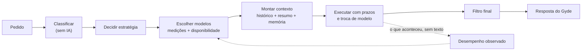

# A inteligência do Gyde

O Gyde não é um chatbot preso a um modelo, e também não é um seletor de modelos: um núcleo próprio lê cada pedido, escolhe
a estratégia e usa os modelos como peças. Para a pessoa, quem responde é sempre o Gyde, com a mesma voz, as mesmas regras
e a mesma memória.

Tudo aqui foi medido neste computador, com chamadas reais e correção automática. Os resultados e os dados brutos estão em
[avaliacao/](avaliacao/README.md). Não há comparação com ChatGPT, Claude, Gemini ou Grok: isso exigiria testes independentes,
que não foram feitos.

## O que a auditoria encontrou

| Problema no sistema anterior | O que isso causava | O que foi feito |
|---|---|---|
| Ordem de modelos fixa, escrita no código | O `qwen3.8-27b` vinha em primeiro por ser rápido, mas aceita poucas chamadas por minuto: numa rodada sem pausa, 20 de 24 tarefas pararam no limite | A ordem vem de medições e do que está disponível agora |
| Nome de modelo tratado como se dissesse quem responde | Os nomes `claude-*` do FreeLLMAPI não são Claude: foram atendidos por qwen, gpt-oss, Gemini e outros | A medição guarda quem respondeu de verdade; "outro modelo" é conferido pelo modelo real |
| Conversa inteira e todos os anexos em toda chamada | Recusa por tamanho (413) nos modelos grátis | Contexto selecionado, com resumo do que ficou de fora |
| Imagem antiga continuava indo na conversa | Modelos sem visão recusavam a conversa inteira | Imagem antiga vira uma nota no texto |
| Sem prazo nas chamadas | Um modelo travado segurava o pedido sem limite | Prazo por tentativa, entre pedaços e no total, com troca de modelo |
| Falha repetida no mesmo modelo | Cota gasta à toa em quem acabou de recusar | Quem dá limite descansa; 413 só barra pedidos daquele tamanho |
| Uma instrução só para qualquer pedido | Conversa simples recebia resposta longa, com títulos | Identidade única + complemento por tipo de tarefa |
| Raciocínio cru, introduções e emojis chegavam à tela conforme o modelo | Respostas com cara de modelos diferentes | Filtro final igual para todos |

## Como uma resposta nasce



| Peça | Arquivo em `pacotes/servidor/ia/` | Função |
|---|---|---|
| Classificação | `classificar.ts` | Tipo de tarefa, complexidade, importância e dúvida, por regras: sem custo e testável |
| Decisão | `orquestrador.ts` (`decidirEstrategia`) | Função pura: mesma entrada, mesma estratégia |
| Perfis e escolha | `catalogo.ts` + `medicoes.json` | Qualidade por categoria (medida), contexto e disponibilidade (do provedor), sucesso e tempo recentes (observados) |
| Desempenho | `desempenho.ts` | Taxa de sucesso, tempo e limites por modelo. Só números, nenhum texto de conversa |
| Contexto | `contexto.ts` | Mensagem atual inteira; anteriores até o limite; o resto vira resumo |
| Instruções | `prompts.ts` | Identidade, complemento por tarefa, papéis internos e ajustes por família de modelo |
| Resposta final | `filtro.ts` | Tira `<think>`, introdução vazia e emoji, também em streaming |
| Provedores | `adaptadores.ts` | Endereço, autenticação, parâmetros e erros de cada provedor |
| Preferências e tela | `rotas.ts` | Modo de resposta, modelos ligados e "Como o Gyde funciona" |

**Nenhuma nota é dada à mão.** A posição de um modelo vem de acertos medidos (com correção para amostra pequena: sem
medição vale meio, abaixo de quem provou qualidade), vezes a chance de ele estar disponível, menos o custo do tempo no
modo escolhido. Modelo que respondeu e errou todas as vezes numa categoria sai dela.

## As estratégias

| Estratégia | Como funciona | Quando é usada |
|---|---|---|
| **Um modelo** | O melhor para a tarefa, em streaming | O padrão |
| **Com revisão** | Um escreve, outro procura erros, o primeiro corrige só o que for grave | Quando a pessoa diz que é importante; no modo Capricho, em código |
| **Comparada** | Dois respondem sem ver um ao outro, e o Gyde escreve uma resposta só | Modo Capricho, em raciocínio ou dúvida |
| **Especialistas** | Um analisa, outro implementa, outro confere | Desligada por padrão: precisa ser ligada, e só vale no modo Capricho, para um sistema inteiro |
| **Troca de modelo** | Falhou, deu limite ou respondeu fora do formato: passa para o próximo, sem laço (no máximo 6 tentativas) | Em todas |

Falha num papel de apoio nunca derruba a resposta: a pessoa recebe o melhor que existir até ali. A colaboração inteira tem
prazo de 150 s; se estourar antes de mostrar algo, um modelo só responde.

**Sem falsa colaboração:** o selo "conferida por um 2º modelo" só aparece se outro modelo real revisou. Dois apelidos que
caem no mesmo modelo não contam.

**Por que um modelo só é o padrão:** as medições não mostraram ganho da colaboração nestas tarefas, e ela custa cerca de 3
vezes mais cota. Detalhes em [avaliacao/](avaliacao/README.md#estratégias-antes-e-depois).

## Forja

A Forja não usa o fluxo do chat. A ordem de modelos vem da categoria "projeto grande" e é refeita a cada rodada, porque o
pedido cresce. Depois de mudar arquivos e rodar os testes, outro modelo lê as mudanças uma vez, sem nenhuma ferramenta. Quem
corrige é o modelo que está trabalhando, então nunca há dois modelos mexendo nos arquivos.

## Adicionar um modelo ou provedor

**Modelo do FreeLLMAPI:** meça e gere o arquivo que o orquestrador lê. Nada de código muda.

```bash
node ferramentas/avaliar-modelos.mjs --modelos novo-modelo --saida docs/avaliacao/modelos-novo.json
```

```bash
node ferramentas/gerar-medicoes.mjs docs/avaliacao/modelos-2026-11-04.json docs/avaliacao/modelos-2026-11-04-b.json docs/avaliacao/modelos-2026-11-04-c.json docs/avaliacao/modelos-novo.json
```

**Outro provedor no formato da OpenAI:** crie `modelos-extras.json` na pasta de dados e ponha a chave no `.env`. O arquivo
guarda só o **nome** da variável, nunca a chave. Sem medição, o modelo entra depois dos que já provaram qualidade.

```json
{
  "provedores": [{
    "id": "meuprovedor",
    "url": "https://api.exemplo.com/v1",
    "chaveEnv": "MEUPROVEDOR_API_KEY",
    "naoAceita": ["stream_options"],
    "modelos": [{ "id": "modelo-x", "contexto": 128000, "visao": false }]
  }]
}
```

Arquivo com erro é ignorado sem derrubar o Gyde, e a tela "Como o Gyde funciona" diz o motivo.

## O que não foi feito

- **Pesquisa externa:** o orquestrador não busca na internet, porque o Gyde não tem essa ferramenta hoje.
- **Cache de respostas do chat:** "Gerar de novo" precisa de outra resposta, e a mesma frase muda de sentido conforme a
  conversa. Só a lista de modelos (5 minutos) e o resumo de conversas longas ficam guardados.
- **Ferramentas nativas dos modelos:** foram medidas, mas a Forja continua no formato próprio em JSON, que funciona com
  qualquer modelo.
- **Aprender sozinho com avaliações:** o que muda sozinho é a disponibilidade observada; a qualidade só muda quando alguém
  roda a avaliação de novo.
- **Limites de cada provedor:** o Gyde não adivinha cota. Ele lê o que o provedor informa e reage às recusas.
