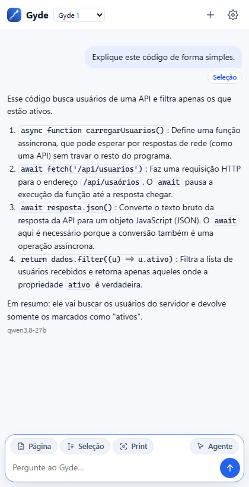

# Gyde para Chrome

Painel lateral do Gyde dentro do navegador. Ele lê a página aberta, o texto que você selecionar ou um print da tela, e
te explica. No **modo agente**, você dá o comando e ele faz sozinho na aba aberta.

## Antes de tudo: o app do Gyde

A extensão conversa com o **app do Gyde**, grátis, que roda no seu computador. A IA também é a do app.

1. Instale o app pelo [COMO-INSTALAR](https://github.com/gustavomdeschamps/Gyde/blob/main/COMO-INSTALAR.md).
2. No app, conecte a IA em **Configurações → Conectar IA** (uma chave grátis da NVIDIA ou do Google).

## Instalar a extensão

Enquanto ela não está na Chrome Web Store, instale pela pasta:

1. No Chrome, abra `chrome://extensions`.
2. Ligue o **Modo do desenvolvedor** (canto superior direito).
3. Clique em **Carregar sem compactação** e escolha a pasta `pacotes\extensao-chrome` (dentro da pasta do Gyde baixada
   do GitHub).
4. Fixe o ícone do Gyde na barra (ícone de peça de quebra-cabeça → alfinete).

## Conectar

1. Com o app do Gyde aberto, vá em **Configurações → Extensões → Gerar token** e copie o token.
2. Clique no ícone do Gyde no Chrome (ou **Alt+G**), cole o token e clique em **Conectar**.

O token só serve para conversar e para o modo agente: com ele a extensão não lê nem muda as suas chaves, as
configurações, a Forja ou os seus dados.

Ao abrir, o painel já avisa (antes da primeira pergunta) se a IA do app ainda não está conectada e se o app está numa
versão mais antiga que a extensão.

## Usar

- **Página**, **Seleção** e **Print**: anexam o conteúdo da aba atual à pergunta.
- Botão direito num texto selecionado: **Explicar com o Gyde** ou **Revisar este código com o Gyde**.
- Botão direito na página: **Perguntar ao Gyde sobre esta página**.
- No topo do painel: **Gyde 1** ou **Gyde 1 Pro** (um segundo modelo confere a resposta). Embaixo de cada resposta
  aparece o modelo que respondeu.
- Os comandos das suas skills (como `/revisar`) também funcionam aqui.

## Modo agente

Clique em **Agente** e dê o comando (ex.: "procure no MDN como usar fetch e abra o exemplo"). O Gyde faz sozinho na
aba aberta: uma **seta azul** vai até cada botão ou campo, clica e digita letra por letra. O painel mostra cada passo
e o botão **Parar** encerra na hora.

Ele só para e pergunta quando:
- falta uma informação que só você sabe;
- a ação não tem volta e você não pediu: comprar, pagar, excluir, mudar a conta, ou enviar algo que não estava no
  comando;
- o campo é de senha, cartão, CPF ou código de verificação (esses ele nunca preenche);
- aparece um captcha, ou a aba é uma página interna do navegador (`chrome://`, loja de extensões).

O que está escrito nos sites é tratado como informação, não como ordem: se uma página tentar mandar o agente fazer
outra coisa, ele ignora. Prefere aprovar cada passo? Marque **pedir permissão a cada passo**.

O agente age dentro do navegador (na aba aberta); ele não controla outros programas do computador.

## Problemas comuns

| O que aparece | O que fazer |
|---|---|
| "Não consegui falar com o Gyde" | Abra o app do Gyde e tente de novo. |
| "A IA do Gyde ainda não está conectada" | No app, abra **Configurações → Conectar IA** e cole uma chave grátis. |
| Token inválido | Gere outro no app (**Configurações → Extensões**) e conecte de novo (botão de engrenagem no painel). |
| "O app do Gyde está desatualizado" | Instale o app novo por cima ([página Releases](https://github.com/gustavomdeschamps/Gyde/releases/latest)). Suas conversas continuam. |

Para atualizar a extensão depois de uma versão nova: `chrome://extensions` → Gyde → ↻.
