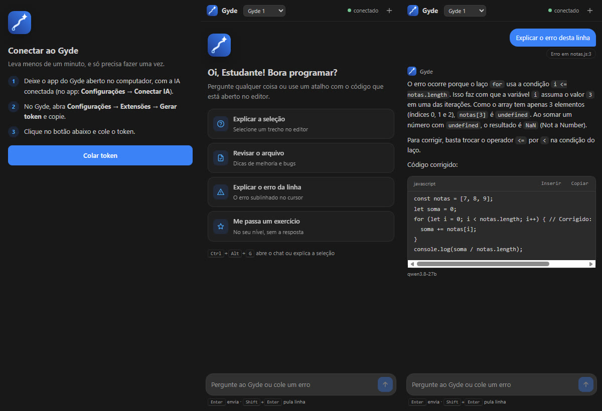
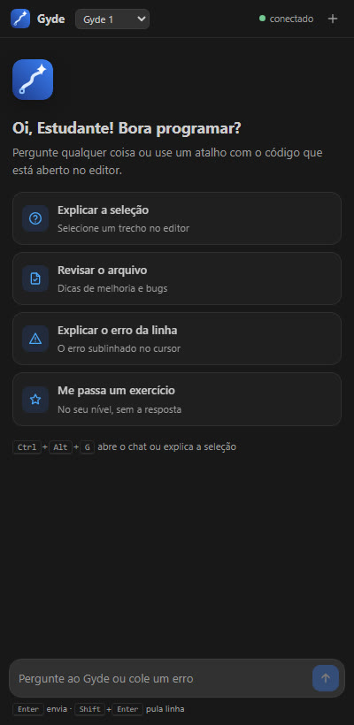
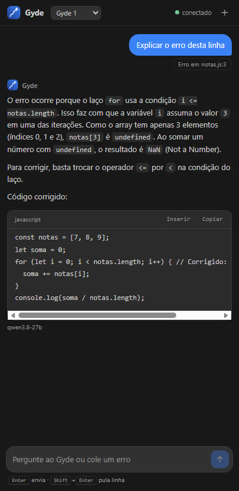
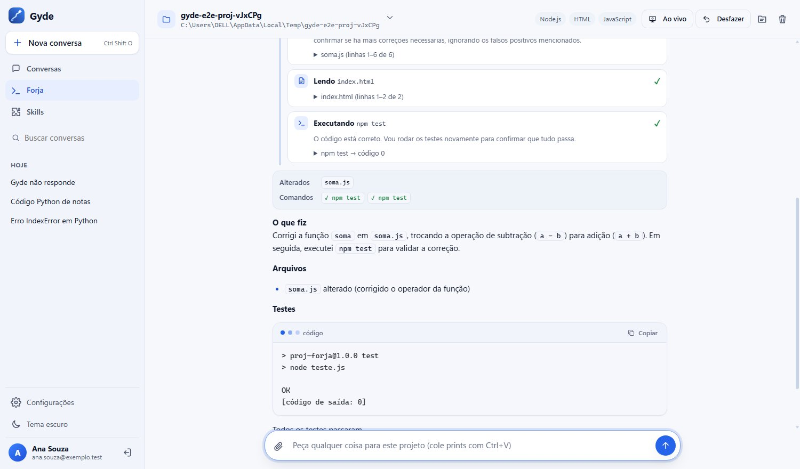

# Gyde: tutor de programação com IA

**Entenda o erro, não só corrija.** O Gyde é um tutor de programação com IA, em português, dentro do VS Code.
Selecione um código e ele explica. Clique numa linha com erro e ele mostra **onde está, por que acontece e como
corrigir**, no nível de quem está aprendendo. Grátis.

## O que ele faz

| | |
|---|---|
| **Explicar com o Gyde** | Selecione um trecho e aperte `Ctrl+Alt+G` (ou botão direito). O Gyde explica linha por linha. |
| **Explicar o erro desta linha** | Com o cursor numa linha sublinhada de vermelho: ele lê o erro e o código em volta e explica a causa. |
| **Revisar com o Gyde** | Revisa a seleção ou o arquivo inteiro: bugs, nomes, organização e dicas para melhorar. |
| **Chat na barra lateral** | Pergunte qualquer coisa de programação. As respostas vêm formatadas, com blocos de código. |
| **Gyde 1 ou Gyde 1 Pro** | No topo do painel. O Gyde escolhe o modelo certo para cada pedido; no Pro, um segundo modelo confere a resposta. Embaixo de cada resposta aparece o modelo que respondeu. |
| **Pedir à Forja** | Botão direito num arquivo: escolha o pedido (melhorias, explicar, simplificar, achar bugs, testes) e confira o texto. Ele aparece no app do Gyde; lá, **Abrir na Forja** abre a Forja da pasta com o pedido escrito, e quem envia é você. Daqui não roda nada. |
| **Inserir no editor** | Cada bloco de código da resposta tem **Inserir** (no cursor) e **Copiar**. |
| **Skills** | Use as suas skills do Gyde no chat, como `/revisar`, `/git` e `/sql`. |
| **Continua no app** | A conversa fica salva: **abrir no Gyde** mostra a mesma conversa no app completo. |

  
  

## Como começar

A extensão conversa com o **app do Gyde**, grátis, que roda no seu computador (Windows). A IA também é a do app.

1. **Instale o app do Gyde** pelo passo a passo:
   [COMO-INSTALAR](https://github.com/gustavomdeschamps/Gyde/blob/main/COMO-INSTALAR.md).
2. **Conecte a IA no app:** em **Configurações → Conectar IA**, cole uma chave grátis da NVIDIA ou do Google
   (o app ensina a criar; leva uns 2 minutos).
3. No app, abra **Configurações → Extensões → Gerar token** e copie o token.
4. No VS Code, clique no ícone do Gyde na barra da esquerda e em **Colar token**.

Pronto. O token fica guardado no cofre de senhas do VS Code. Para sair: comando **Gyde: Desconectar**.

O token só serve para conversar e para deixar um pedido para a Forja: com ele a extensão não lê nem muda as suas
chaves, as configurações ou os seus dados, e não roda nada no seu projeto. Isso tudo fica só no app.

Ao abrir, o painel avisa se a IA do app ainda não está conectada e se o app está numa versão mais antiga que a
extensão.

## O app completo, de graça

Além do chat, o app do Gyde tem:

- **Forja, o agente de código:** abra a pasta de um projeto, peça uma tarefa e ela trabalha sozinha: lê o código,
  edita, roda os testes e mostra o que mudou.
- **Ao vivo:** liga o seu projeto (React, Vue, Vite, site de HTML, Python e outros) e mostra ao lado da conversa.
- **Cidade do código:** o projeto vira uma cidade em 3D, e o prédio acende quando a Forja mexe no arquivo.
- **Passo a passo:** roda o código linha por linha mostrando o valor de cada variável.

## Comandos e atalhos

| Comando | Atalho | Onde |
|---|---|---|
| Gyde: Abrir o chat | `Ctrl+Alt+G` (sem seleção) | Paleta de comandos |
| Explicar com o Gyde | `Ctrl+Alt+G` (com seleção) | Botão direito no editor |
| Revisar com o Gyde | | Botão direito no editor |
| Explicar o erro desta linha | | Botão direito no editor |
| Gyde: Pedir à Forja (abre no app do Gyde) | | Botão direito no editor ou num arquivo do Explorer |
| Gyde: Nova conversa | | Botão `+` no painel |
| Gyde: Conectar (colar token) | | Paleta de comandos |
| Gyde: Desconectar | | Paleta de comandos |

## Configuração

| Opção | Padrão | Para que serve |
|---|---|---|
| `gyde.servidor` | `http://127.0.0.1:3210` | Endereço do app do Gyde. Só mude se a porta do Gyde for outra. |

## Privacidade

A extensão só conversa com o app do Gyde do **seu** computador. Ela manda o código que você selecionou ou o arquivo
que pediu para revisar, e nada mais. O app manda a pergunta para o serviço de IA que você conectou (NVIDIA, Google
ou Groq). Sua conta e suas conversas ficam no seu computador.

## Problemas comuns

| O que aparece | O que fazer |
|---|---|
| "Não consegui falar com o Gyde" | Abra o app do Gyde e tente de novo. |
| "A IA do Gyde ainda não está conectada" | No app, abra **Configurações → Conectar IA** e cole uma chave grátis. |
| Token inválido | Gere outro no app (**Configurações → Extensões**) e use **Gyde: Conectar**. |
| "O app do Gyde está desatualizado" | Instale o app novo por cima ([página Releases](https://github.com/gustavomdeschamps/Gyde/releases/latest)). Suas conversas continuam. |
| O ícone não aparece | Recarregue o VS Code: `Ctrl+Shift+P` → **Reload Window**. |

---

Feito por **Gustavo Moreira Deschamps**. Código aberto (licença MIT):
[github.com/gustavomdeschamps/Gyde](https://github.com/gustavomdeschamps/Gyde).
Achou um problema? [Abra uma issue](https://github.com/gustavomdeschamps/Gyde/issues).
